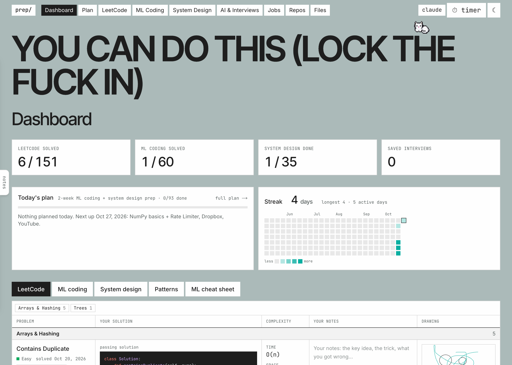
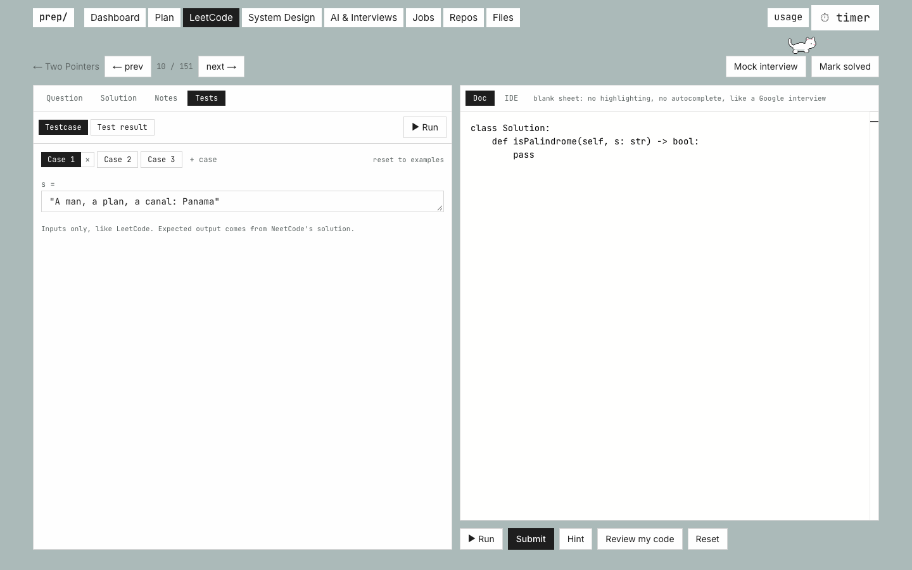

# prep/

**A local, file-based study app for coding and system design interviews**, with Claude as your interviewer, test writer and study planner.

   



## Features

| | |
|---|---|
| **LeetCode** | NeetCode 250, plus Union-Find, Segment Tree and Line Sweep topics, on a roadmap flowchart, or one scrollable list by topic. Prev/next and shuffle mode (topic hidden). Solve in **Python or C++** (LeetCode's C++ starters, NeetCode's C++ solutions, the same hidden tests). |
| **ML Coding** | 85 NumPy, pandas and PyTorch exercises for ML interviews (NumPy and pandas basics, tensors, training steps, ML from scratch), on the same problem page with Run and hidden-test Submit. Have Claude generate more, or add your own from `content/ml-coding/_template/`. |
| **Problem page** | LeetCode starter code, a Google-Doc-style editor (no autocomplete), **Run** your own inputs against NeetCode's solution, **Submit** to hidden tests (works without Claude), optionally stating your time and space complexity, which Claude checks against your code. Hints and a complexity check from Claude. Move a problem to any topic. |
| **System design** | 32 problems with solutions, your Excalidraw diagrams, 17 Hello Interview videos, and your own notes canvas. |
| **Anki** | Anki-style flashcards with spaced repetition: import an Anki deck (`.apkg` or plain text, with images; needs Node 22.15+), edit cards in the app, or have Claude generate a deck on any topic. Today's due and new cards show on the dashboard. Decks are Markdown files in `content/decks/`. |
| **Mock interviews** | Coding or system design interviews with Claude. The timer starts on its own, and you get feedback and a saved transcript. |
| **Review** | A dashboard cheat sheet of your solved problems (your code, notes, drawings), spaced repetition and a patterns sheet. |
| **Plan** | Claude writes a day-by-day study plan from your progress, including reviews. Streak calendar on the dashboard. |
| **Extras** | Light/dark switch, job application tracker, git repo browser (open and run Jupyter notebooks in place), file browser, timer, Claude model picker and usage, a mantra and a pettable cat. |



## Quick start

Needs **Node 20+** and **Python 3**, plus a **C++ compiler** for C++ answers (Xcode Command Line Tools on macOS, `g++` on Linux and Windows), on macOS, Linux or Windows. For the AI features, [set up Claude](#set-up-claude) too.

```bash
npm start             # installs, builds and opens http://localhost:3000 in your browser (Ctrl+C stops it)
npm run setup-python  # optional: numpy, pandas, torch and Jupyter for ML Coding and notebooks
```

`npm start` only reinstalls or rebuilds when something changed, so after the first time it opens in seconds. Use `npm run dev` while editing the code. Your data stays in `content/`.

## Set up Claude

The AI features (adding and generating problems, hidden tests, hints, mock interviews, study plans and the Claude page) run through **Claude Code** on your machine. Everything else works without it.

1. **Install Claude Code**
   ```bash
   npm install -g @anthropic-ai/claude-code
   ```
   Other install options are in the [Claude Code docs](https://docs.claude.com/en/docs/claude-code/setup).

2. **Log in once**: run `claude auth login` and finish signing in in your browser. Or open the app's **claude** page and click **Log in to Claude**, which opens a terminal with that command for you on macOS, Windows or Linux. A Claude Pro or Max subscription works, and so does an Anthropic API key (`ANTHROPIC_API_KEY`).

3. **Check it works**
   ```bash
   claude -p "say hi"
   ```
   If that prints a reply, the app can use Claude. The **claude** page also shows whether Claude Code is connected, lets you pick the model, and shows how much of your plan is used.

> If `claude` isn't on your `PATH`, point the app at it in `.env.local`: `CLAUDE_BIN=/full/path/to/claude`.
> The app uses whatever account Claude Code is logged into. It never asks for or stores a key, and usage counts against that account. Check how much is used with the **claude** button.

## How it works

- **Your data is plain files** in `content/`: markdown, Python and JSON you can open, edit or back up. Your progress, notes, plans and jobs are git-ignored.
- **AI runs through your local Claude Code** (`claude -p`), with no tools that can change files. The app writes everything itself.
- **Prompts are editable** in `content/prompts/`, to change how Claude writes problems, tests, plans and interviews.
- **Runs only on your machine** (127.0.0.1). Your code runs unsandboxed with a 10-second limit, so don't expose the app on a network.

### How C++ answers are compiled

Each Run or Submit of a C++ LeetCode answer compiles it with your system compiler (`c++`, or `g++` on Windows; set `CXX` to use another) with `-std=c++20 -O2` (plus libc++'s fast bounds checks on macOS), for speed like LeetCode's judge. Your file is compiled together with a small `main` that the Python tests talk to, plus LeetCode's usual setup: the common headers, `using namespace std`, `ListNode` and `TreeNode`. Compiling takes about a second, and an answer that hasn't changed isn't compiled again. A run gets 30 seconds including compiling.

```
content/
├── leetcode/<topic>/<problem>/      question · solution · starter · tests · your code & notes
├── system-design/<category>/<problem>/   question · solution · diagrams · your notes
├── prompts/                          what the app asks Claude
└── patterns.md · plan.json · jobs.json · progress.json · …
```

<details>
<summary><b>Scripts</b></summary>

| Command | What it does |
|---|---|
| `npm start` | Install and build if needed, start the server and open the browser |
| `npm run dev` | Development server |
| `npm test` | Unit tests |
| `node scripts/generate-tests.ts` | Pre-generate hidden tests for all problems (`--model`, `--jobs`, `--force`) |
| `npm run fetch` | Re-download LeetCode starters and NeetCode solutions |
| `node scripts/fetch-hld.ts` | Download Hello Interview's high-level and final design diagrams for the free breakdowns (git-ignored, shown instead of the Excalidraw ones) |
| `node scripts/add-problems.ts <list.json>` | Add LeetCode problems in bulk, like Add from link (Claude writes them, then their hidden tests). `scripts/new-problems.json` is the list used for the NeetCode 250 |
| `node scripts/fetch-videos.ts` | Add NeetCode's YouTube video to each LeetCode problem (shown in the Solution tab) |
| `node scripts/fetch-cpp.ts` | Re-download LeetCode's C++ starters and NeetCode's C++ solutions |
| `npm run setup-python` | Install numpy, pandas, torch and Jupyter into `.venv` for ML Coding and notebooks |
| `node scripts/check-problems.ts <dir>` | Check problems (Python or C++): examples run, hidden tests pass with the reference and fail with the starter |

</details>


## Credits

Solutions from [NeetCode](https://neetcode.io) ([neetcode-gh/leetcode](https://github.com/neetcode-gh/leetcode), MIT), following the NeetCode roadmap (NeetCode 250). Problems and starter code from [LeetCode](https://leetcode.com). System design videos by [Hello Interview](https://www.hellointerview.com). Not affiliated with any of them. See [THIRD_PARTY_NOTICES.md](THIRD_PARTY_NOTICES.md).
