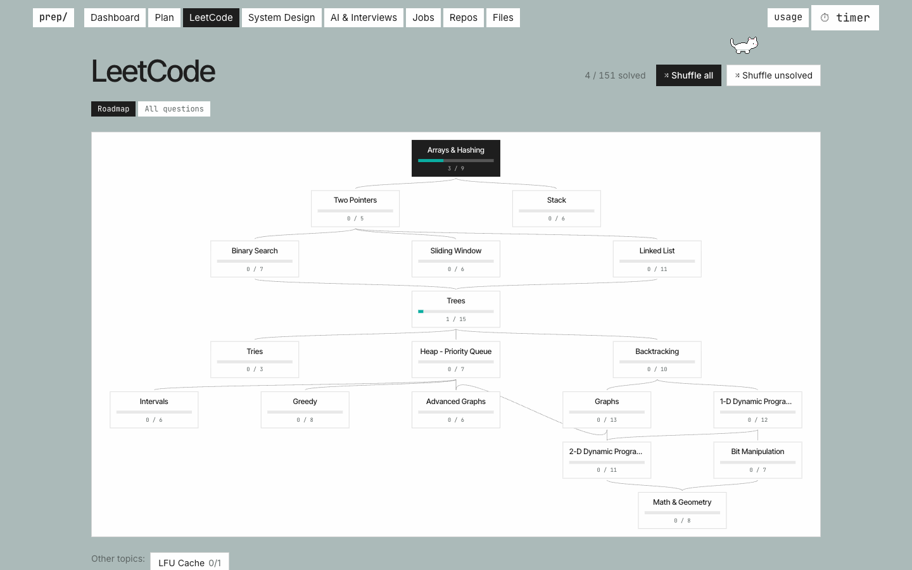
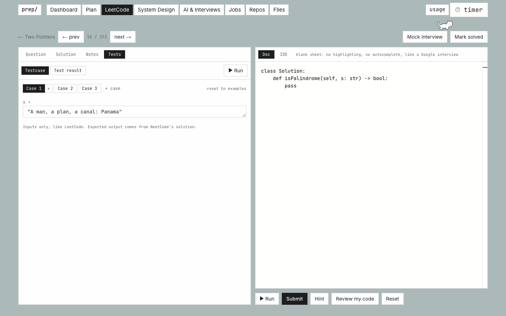

# prep/

**A local, file-based study app for coding and system design interviews**, with Claude as your interviewer, test writer and study planner.

   

<picture>
  <source media="(prefers-color-scheme: dark)" srcset="docs/roadmap-dark.png">
  
</picture>

## Features

| | |
|---|---|
| **LeetCode** | NeetCode 150 on a roadmap flowchart, or one scrollable list by topic. Prev/next and shuffle mode (topic hidden). |
| **Problem page** | LeetCode starter code, a Google-Doc-style editor (no autocomplete), **Run** your own inputs against NeetCode's solution, **Submit** to hidden tests. Hints and code review from Claude. |
| **System design** | 32 problems with solutions, your Excalidraw diagrams, 17 Hello Interview videos, and your own notes canvas. |
| **Mock interviews** | Coding or system design interviews with Claude. The timer starts on its own, and you get feedback and a saved transcript. |
| **Review** | A dashboard cheat sheet of your solved problems (your code, notes, drawings), spaced repetition and a patterns sheet. |
| **Plan** | Claude writes a day-by-day study plan from your progress, including reviews. Streak calendar on the dashboard. |
| **Extras** | Light/dark switch, job application tracker, git repo browser, file browser, timer, Claude usage left, a mantra and a pettable cat. |

<picture>
  <source media="(prefers-color-scheme: dark)" srcset="docs/problem-dark.png">
  
</picture>

## Quick start

Needs **Node 20+**, **Python 3** and **[Claude Code](https://claude.com/claude-code)** installed and logged in (AI features only, and no API key is needed).

```bash
npm install
npm run app    # builds once, then opens fast at http://localhost:3000
npm run dev    # while editing the code (each page compiles on first visit)
```

## How it works

- **Your data is plain files** in `content/`: markdown, Python and JSON you can open, edit or back up. Your progress, notes, plans and jobs are git-ignored.
- **AI runs through your local Claude Code** (`claude -p`), with no tools that can change files. The app writes everything itself.
- **Prompts are editable** in `content/prompts/`, to change how Claude writes problems, tests, plans and interviews.
- **Runs only on your machine** (127.0.0.1). Your code runs unsandboxed with a 10-second limit, so don't expose the app on a network.

```
content/
├── leetcode/<topic>/<problem>/      question · solution · starter · tests · your code & notes
├── system-design/<category>/<problem>/   question · solution · diagrams · your notes
├── prompts/                          what the app asks Claude
└── patterns.md · plan.json · jobs.json · progress.json · …
```

<details>
<summary><b>Scripts</b></summary>

| Command | What it does |
|---|---|
| `npm run app` | Production build + server (fast) |
| `npm run dev` | Development server |
| `npm test` | Unit tests |
| `node scripts/generate-tests.ts` | Pre-generate hidden tests for all problems (`--model`, `--jobs`, `--force`) |
| `npm run fetch` | Re-download LeetCode starters and NeetCode solutions |
| `npm run import-diagrams` | Import Excalidraw diagrams from an Obsidian vault |
| `npm run seed` | Rebuild `content/` from an Obsidian vault (one-off) |

</details>


## Credits

Solutions from [NeetCode](https://neetcode.io) ([neetcode-gh/leetcode](https://github.com/neetcode-gh/leetcode), MIT), following the NeetCode 150 roadmap. Problems and starter code from [LeetCode](https://leetcode.com). System design videos by [Hello Interview](https://www.hellointerview.com). Not affiliated with any of them. See [THIRD_PARTY_NOTICES.md](THIRD_PARTY_NOTICES.md).
